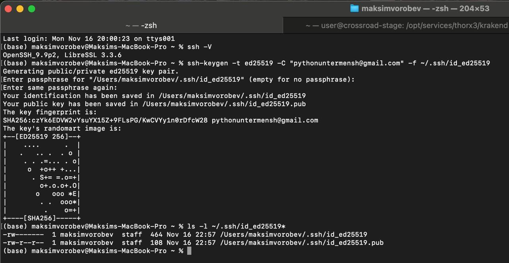
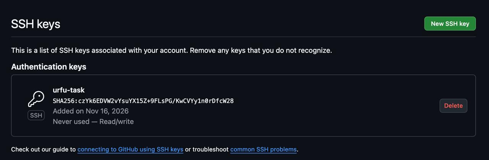
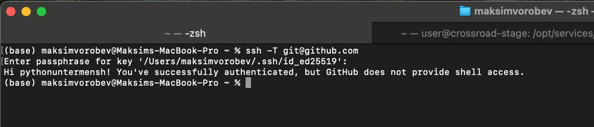

# SSH-доступ к GitHub

## 1. Генерация ключей

Проверил SSH-клиент. Создал ключ ed25519 (публичный и приватный) с заданным passphrase:

```bash
ssh-keygen -t ed25519 -C "pythonuntermensh@gmail.com" -f ~/.ssh/id_ed25519
```

Приватный и публичный ключи сохранены в `~/.ssh/`.



## 2. Добавление ключа в GitHub

Добавил публичный ключ `~/.ssh/id_ed25519.pub` в GitHub.



## 3. Проверка подключения

Выполнил:

```bash
ssh -T git@github.com
```

После ввода passphrase GitHub подтвердил успешную аутентификацию.


